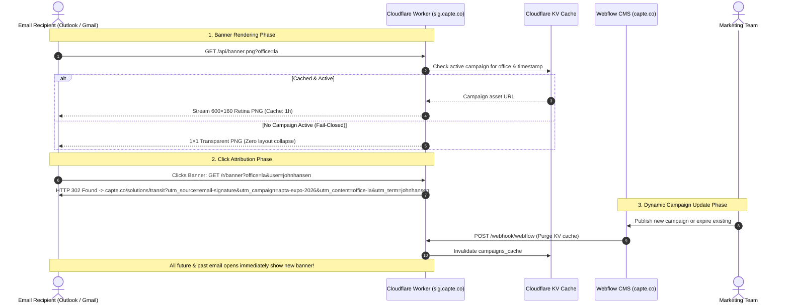

# Capte Technologies — Centralized Signature Edge Router (`sig.capte.co`)

> **Domain**: `sig.capte.co`  
> **Infrastructure**: Cloudflare Workers (V8 Edge Compute) + Webflow Enterprise CMS  
> **Status**: Production Scaffold & Architecture Tested  
> **Owner**: John Hansen ([john@capte.co](mailto:john@capte.co)) — Digital Design & Web Operations  

This edge service provides the high-performance routing backbone for Capte's centralized email signatures. It delivers dynamically scheduled marketing banners, automated GA4 campaign attribution, fail-closed inbox rendering, and pre-filled employee generator onboarding.

---

## 🚀 Executive Value Proposition

Traditional enterprise email signature services (CodeTwo, Exclaimer) require routing all company email through third-party cloud SMTP proxies at \$1.22–\$1.45/user/month (\$250–\$500+/year recurring), creating significant GDPR compliance exposure for European offices.

**The Capte Custom Edge Router solves this completely:**
- **\$0.00 / month running cost** on Cloudflare's free edge tier (up to 100,000 requests/day).
- **100% data privacy & GDPR compliance**: No email body or employee credentials ever touch external servers. All email transport stays entirely inside Microsoft 365.
- **Native Webflow CMS workflow**: Marketing manages campaign assets, date schedules, and landing page URLs in Webflow Designer without touching code.
- **Zero staff intervention**: Marketing can launch, swap, or expire banners for 100% of employees in real time with zero staff reinstallation.

---

## 🏛️ System Architecture & Request Lifecycle



---

## 🎯 High-Impact Enterprise Use Cases

### 1. Major Trade Show & Expo Takeovers (Time-Gated)
* **Scenario**: Capte exhibits at **APTA TRANSform Expo** (Anaheim, CA) from Oct 12–15.
* **Execution**: Marketing creates a campaign in Webflow targeting `office: la` with start date `Oct 1` and end date `Oct 15, 18:00`.
* **Result**: On Oct 1, all outbound sales and executive emails automatically display the APTA booth invitation. At 18:01 on Oct 15, the banner automatically vanishes and reverts to evergreen brand messaging without any employee updating their settings.

### 2. Regional / International Split-Testing
* **Scenario**: US sales reps pitch transit bus telemetry; European offices (France & Netherlands) pitch heavy rail positioning systems and InnoTrans Berlin.
* **Execution**: The router inspects `?office={la|fr|nl}`:
  - US recipients see: *“Next-Gen Transit Telemetry — Meet Us at APTA”*
  - EU recipients see: *“Precision Rail GNSS — Discover InnoTrans Showcase”* in local languages.
* **Result**: Hyper-localized marketing relevance with zero cross-office friction.

### 3. Granular Sales Lead Attribution in GA4
* **Scenario**: Sales reps send thousands of outbound outreach emails to prospective fleet managers each week.
* **Execution**: The router tags clicks with sender-specific UTM terms (`&utm_term=s.chen`).
* **Result**: When a fleet operator clicks the banner, Google Analytics 4 attributes the inbound trial demo request to the specific sales executive who initiated the correspondence.

### 4. Critical Service Advisories & Holiday Operating Schedules
* **Scenario**: Year-end customer support schedules, system maintenance windows, or European holiday closures.
* **Execution**: Marketing or operations toggles an informational notice in Webflow CMS.
* **Result**: Instant global dissemination across every email thread in real time.

### 5. Automated Fail-Closed Evergreen Safeguard
* **Scenario**: A campaign reaches its end date on a Sunday, or an external CDN asset has a temporary glitch.
* **Execution**: The worker catches errors and returns a pre-cached 1×1 transparent PNG.
* **Result**: Email clients render clean spacing with **zero broken red "X" image boxes**, protecting enterprise credibility.

---

## 🛠️ Endpoints Specification

| Endpoint | Method | Query Parameters | Response / Behavior |
| :--- | :--- | :--- | :--- |
| **`/api/banner.png`** | `GET` | `?office=la\|fr\|nl&user=...` | Streams active $600 \times 160\text{px}$ banner. Returns binary 1×1 transparent PNG if no campaign is active. Headers: `Cache-Control: public, max-age=3600, s-maxage=86400, stale-while-revalidate=600`. |
| **`/r/banner`** | `GET` | `?office=la\|fr\|nl&user=...` | 302 redirect to active campaign destination URL with injected GA4 parameters: `utm_source=email-signature`, `utm_medium=email`, `utm_campaign={slug}`, `utm_content=office-{office}`, `utm_term={user}`. |
| **`/setup`** | `GET` | `?user={id}&email={email}` | Reads verified employee attributes from [`src/roster.json`](src/roster.json) and redirects to the generator with pre-filled, error-free fields. |
| **`/api/signature`** | `GET` | `?user={id}` | Returns structured JSON payload with full profile and banner URLs. Designed for native integration with Microsoft 365 Outlook Add-in (Phase 2). |
| **`/webhook/webflow`**| `POST` | `Authorization: Bearer <token>` | Webflow CMS publish webhook to instantly invalidate edge cache. |
| **`/health`** | `GET` | None | Returns JSON service status, uptime, and deployment version. |

---

## 💻 Local Development & Testing

1. **Install dependencies**:
   ```bash
   cd workers/sig-router
   npm install
   ```

2. **Run local edge simulator**:
   ```bash
   npx wrangler dev
   ```

3. **Verify endpoints locally**:
   - Dynamic banner: `http://localhost:8787/api/banner.png?office=la`
   - UTM click redirect: `http://localhost:8787/r/banner?office=la&user=johnhansen`
   - Pre-filled setup: `http://localhost:8787/setup?user=johnhansen`
   - JSON profile: `http://localhost:8787/api/signature?user=johnhansen`

---

## 🚢 Production Deployment (`sig.capte.co`)

### 1. DNS Provisioning (IT)
Add a CNAME record in the DNS provider:
- **Type**: `CNAME`
- **Name**: `sig`
- **Target**: Cloudflare Worker zone proxy

### 2. Cloudflare KV Provisioning
Create the KV store for caching Webflow items:
```bash
npx wrangler kv:namespace create CAMPAIGNS_KV
```
Update the returned namespace `id` in [`wrangler.toml`](wrangler.toml).

### 3. Deploy
```bash
npx wrangler deploy
```

---

## 📊 Technical & Financial Comparison

| Evaluation Metric | SaaS Solution (CodeTwo / Exclaimer) | Capte Custom Edge Router (`sig.capte.co`) |
| :--- | :--- | :--- |
| **Annual Running Cost** | \$250 – \$500+ / year (recurring) | **\$0.00 / year** (Permanent free edge tier) |
| **Mail Transport Interception** | Mandatory SMTP relay through vendor cloud proxy | **None**; all mail transport stays internal to M365 |
| **GDPR & Privacy (France/NL)** | Third-party data processor agreement required | **100% Internal**; zero email body data exposed |
| **Campaign Asset Management** | Vendor dashboard (learning curve for marketing) | **Webflow CMS** (tools marketing already uses) |
| **Office Targeting (LA/FR/NL)** | Complex rule builders in vendor UI | **Native Webflow dropdown filter** |
| **Latency Impact on Email** | 200–500ms delay per email while proxy rewrites MIME | **0 ms** (email delivery unaffected; images load at edge) |
| **Fail-Closed Guarantee** | Outages at vendor halt outbound company email | Outages fall back to 1×1 transparent PNG |
